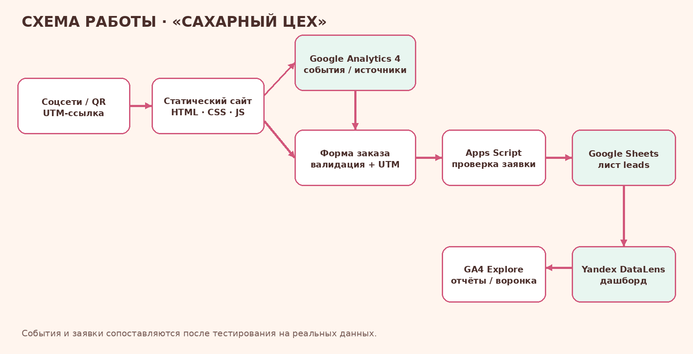

# Описание работы · ТЗ-12/2026 · «Сахарный цех»

**Дисциплина:** ОП.03 «Информационные технологии»  
**Исполнитель:** вписать ФИО и группу  
**Период проверок:** указать фактические даты

> В папке `screens/` должны быть реальные скриншоты ваших аккаунтов и сайта. Не вставляйте фиктивные кадры.

## 1. Задача заказчика
По ТЗ требуется сайт кондитерской с каталогом, конструктором и формой заказа, а также связь UTM-источников, GA4, таблицы заявок и аналитических отчётов.

## 2. Схема работы

Путь посетителя: соцсеть/QR с UTM → сайт → GA4 и форма → Apps Script → Google Sheets `leads` → отчёты GA4 и DataLens.

## 3. Сайт
Подготовлены 9 статических HTML-страниц, адаптивные стили и JS для каталога, конструктора, расчёта порций и формы. После публикации добавить кадры `screens/kursovaya/01-site-home.png`, `02-site-mobile.png`, `screens/lighthouse/lighthouse-mobile.png`.

## 4. GA4
Загрузчик и события подготовлены в `js/analytics.js`. После создания ресурса указать реальный Measurement ID и проверить DebugView. Кадры: `screens/ga4/measurement-id.png`, `screens/ga4/generate-lead-debugview.png`.

## 5. UTM и соцсети
`docs/utm.csv` — реестр кампаний. После публикации заменить URL, создать QR и добавить реальные доказательства в `screens/utm/`.

## 6. Заявки
`builder.html` содержит форму, `apps-script/Code.gs` — обработчик для Google Sheets. Нужно развернуть скрипт, задать `SPREADSHEET_ID`, подключить URL и выполнить тест. Кадры: `screens/kursovaya/04-form.png`, `05-lead-in-sheet.png`.

## 7. ManyChat
Предусмотрены ветки `ГОСТИ` и `ДЕТИ`. Настройка и проверка выполняются в вашем подключённом аккаунте; сохранить кадры комментария и Direct.

## 8. Отчёты и DataLens
Создать Traffic acquisition, 5-шаговую Explore funnel и DataLens с вкладками «Трафик», «Заявки», «Кампании». Числа и выводы добавить только после получения реальных данных.

## 9. Польза для бизнеса
Проект предусматривает единый каталог, стандартизированную форму, хранение источника обращения и возможность сравнивать каналы. Фактический эффект оценивается после тестового потока.

## 10. Итог
**Не получилось на момент подготовки:** внешние аккаунты и публикации не подключены.  
**ИИ использовался для:** чернового кода, документации, схемы и презентации.
